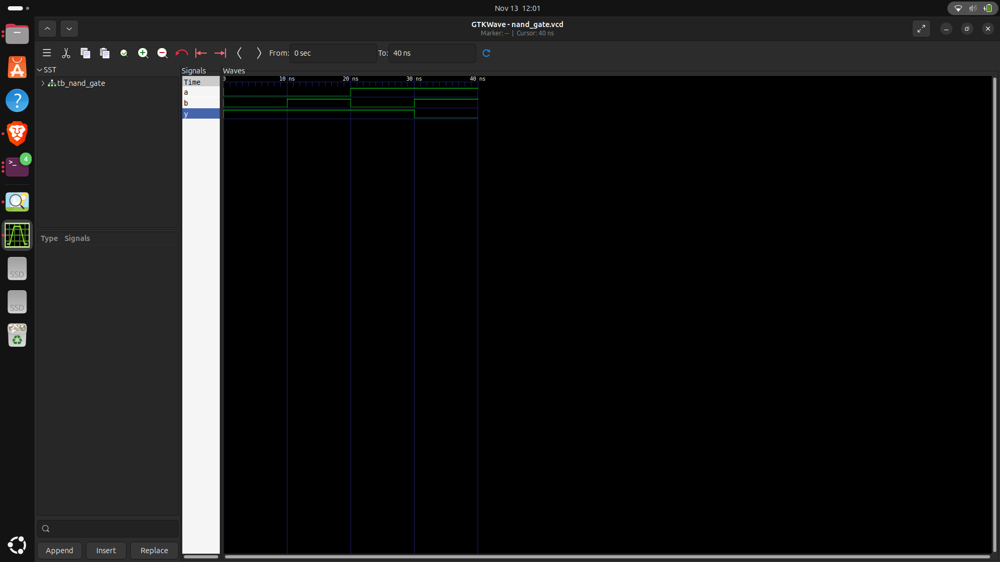
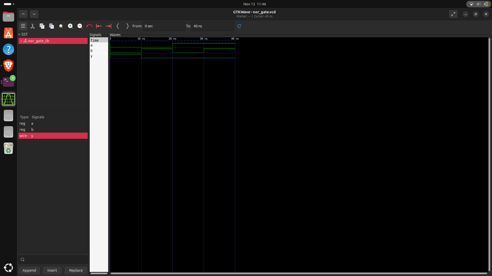
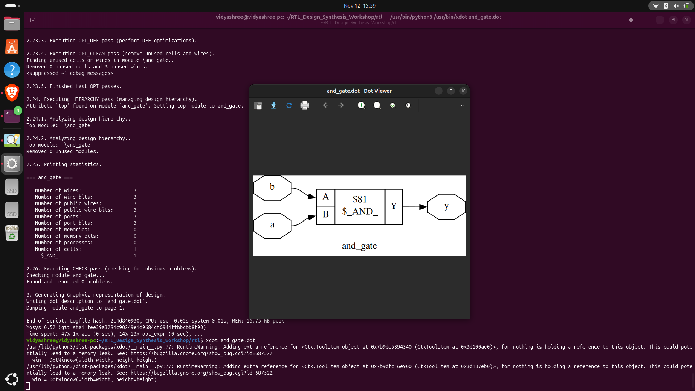
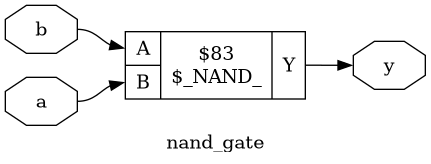
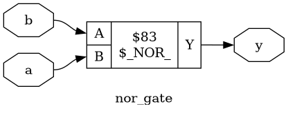
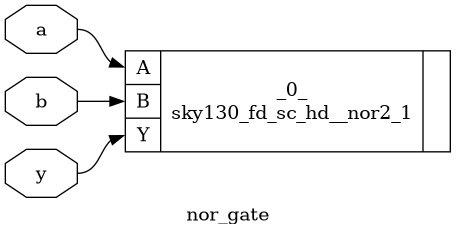
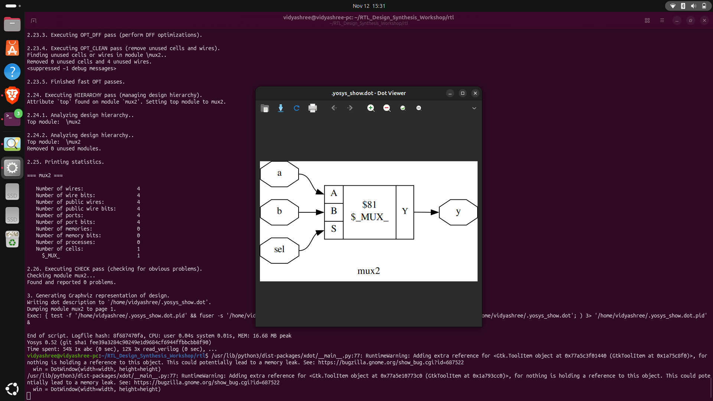
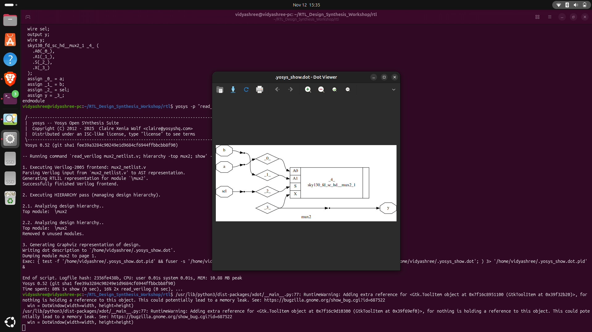

# RTL Design and Synthesis Workshop

## Overview
This project documents the RTL design, functional simulation, logic synthesis, and SKY130 standard-cell mapping of basic digital circuits using open-source EDA tools on Ubuntu Linux.

## Tools Used
- Verilog HDL — RTL design and testbenches
- Icarus Verilog — Functional simulation
- GTKWave — Waveform visualization
- Yosys 0.52 — RTL synthesis and technology mapping
- SKY130A PDK — Standard-cell library
- Graphviz — Synthesis diagram generation
- Ubuntu Linux — Development environment

## RTL Modules
| Circuit | RTL Source | Testbench |
|---|---|---|
| AND Gate | `rtl/and_gate.v` | `rtl/tb_and_gate.v` |
| OR Gate | `rtl/or_gate.v` | `rtl/tb_or_gate.v` |
| NAND Gate | `rtl/nand_gate.v` | `rtl/tb_nand_gate.v` |
| NOR Gate | `rtl/nor_gate.v` | `rtl/nor_gate_tb.v` |
| 2:1 Multiplexer | `rtl/mux2.v` | `rtl/tb_mux2.v` |

## Design Flow
1. Write Verilog RTL modules.
2. Create testbenches for functional verification.
3. Compile and simulate with Icarus Verilog.
4. View simulation waveforms in GTKWave.
5. Synthesize RTL using Yosys.
6. Perform technology mapping with the SKY130 standard-cell library where applicable.
7. Generate synthesis diagrams using Graphviz.

## Simulation Results

### NAND Gate


### NOR Gate
The NOR gate simulation was observed to produce the expected truth table.

| A | B | Y |
|---|---|---|
| 0 | 0 | 1 |
| 0 | 1 | 0 |
| 1 | 0 | 0 |
| 1 | 1 | 0 |



## Synthesis Results

### AND Gate


### OR Gate


### NAND Gate


### NOR Gate


### NOR Gate SKY130 Mapping
Yosys mapped the NOR gate to one `sky130_fd_sc_hd__nor2_1` standard cell.



### 2:1 MUX RTL Synthesis


### 2:1 MUX SKY130 Mapping
The synthesis visualization shows a `sky130_fd_sc_hd__mux2_1` standard cell.



## Project Structure
```text
RTL_Design_Synthesis_Workshop/
├── README.md
├── rtl/
│   ├── and_gate.v
│   ├── or_gate.v
│   ├── nand_gate.v
│   ├── nor_gate.v
│   ├── mux2.v
│   ├── tb_and_gate.v
│   ├── tb_or_gate.v
│   ├── tb_nand_gate.v
│   ├── nor_gate_tb.v
│   ├── tb_mux2.v
│   └── synthesized netlists and simulation artifacts
└── screenshots/
    └── synthesis diagrams and waveforms
```

## Example: Running the NOR Gate Simulation
From the project root:

```bash
cd rtl
iverilog -o nor_gate_sim nor_gate.v nor_gate_tb.v
vvp nor_gate_sim
gtkwave nor_gate.vcd
```

## Verified Observations
- NAND synthesis generated a SKY130 NAND2 standard-cell netlist.
- NOR simulation produced the expected four truth-table combinations.
- NOR technology mapping generated one SKY130 NOR2 standard cell.
- The MUX SKY130 synthesis screenshot shows a SKY130 MUX2 cell.
- Additional AND, OR, NAND, NOR, and MUX synthesis diagrams are included.

## Conclusion
This workshop demonstrates the RTL-to-gate-level design flow for fundamental combinational circuits. It provides practical experience with Verilog simulation, waveform inspection, logic synthesis, and SKY130 standard-cell mapping using open-source EDA tools.

## Scope
This repository covers RTL design and synthesis. It does not claim to include placement, routing, or GDSII generation.
