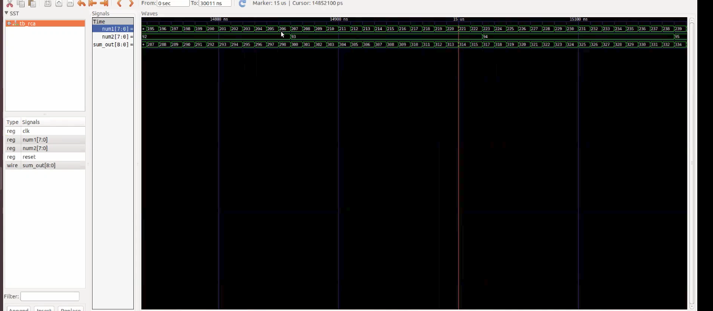
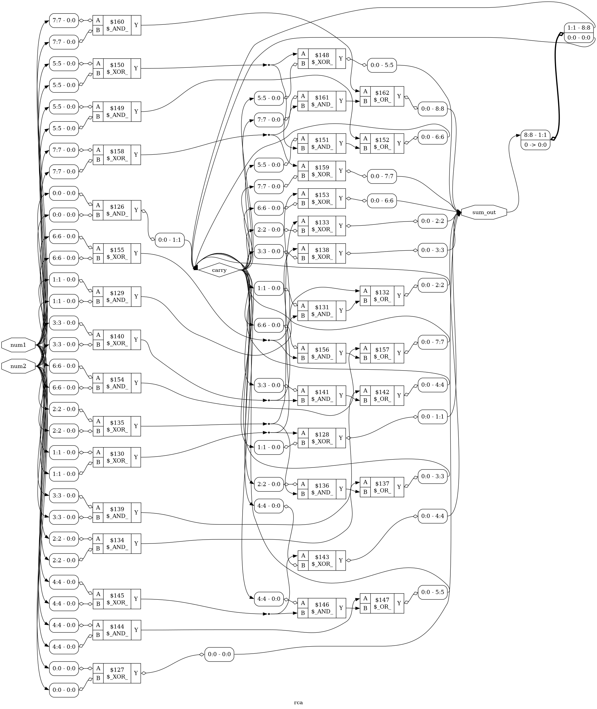
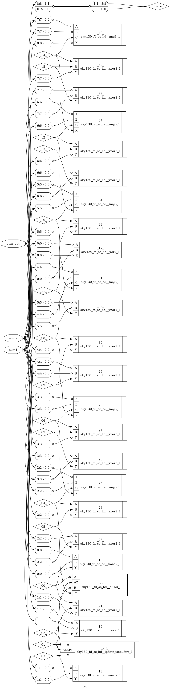

# RTL Design and Synthesis Workshop

## Overview
This project documents the RTL design, functional simulation, logic synthesis, and SKY130 standard-cell mapping of basic digital circuits using open-source EDA tools on Ubuntu Linux.

## Tools Used
- Verilog HDL — RTL design and testbenches
- Icarus Verilog — Functional simulation
- GTKWave — Waveform visualization
- Yosys 0.52 — RTL synthesis and technology mapping
- SKY130A PDK — Standard-cell library
- Graphviz — Synthesis diagram generation
- Ubuntu Linux — Development environment

## RTL Modules
| Circuit | RTL Source | Testbench |
|---|---|---|
| AND Gate | `rtl/and_gate.v` | `rtl/tb_and_gate.v` |
| OR Gate | `rtl/or_gate.v` | `rtl/tb_or_gate.v` |
| NAND Gate | `rtl/nand_gate.v` | `rtl/tb_nand_gate.v` |
| NOR Gate | `rtl/nor_gate.v` | `rtl/nor_gate_tb.v` |
| 2:1 Multiplexer | `rtl/mux2.v` | `rtl/tb_mux2.v` |

## Design Flow
1. Write Verilog RTL modules.
2. Create testbenches for functional verification.
3. Compile and simulate with Icarus Verilog.
4. View simulation waveforms in GTKWave.
5. Synthesize RTL using Yosys.
6. Perform technology mapping with the SKY130 standard-cell library where applicable.
7. Generate synthesis diagrams using Graphviz.

## Simulation Results

### NAND Gate


### NOR Gate
The NOR gate simulation was observed to produce the expected truth table.

| A | B | Y |
|---|---|---|
| 0 | 0 | 1 |
| 0 | 1 | 0 |
| 1 | 0 | 0 |
| 1 | 1 | 0 |


## Synthesis Results

### AND Gate


### OR Gate


### NAND Gate


### NOR Gate


### NOR Gate SKY130 Mapping
Yosys mapped the NOR gate to one `sky130_fd_sc_hd__nor2_1` standard cell.


### 2:1 MUX RTL Synthesis


### 2:1 MUX SKY130 Mapping
The synthesis visualization shows a `sky130_fd_sc_hd__mux2_1` standard cell.


## Project Structure
```text
RTL_Design_Synthesis_Workshop/
├── README.md
├── rtl/
│   ├── and_gate.v
│   ├── or_gate.v
│   ├── nand_gate.v
│   ├── nor_gate.v
│   ├── mux2.v
│   ├── tb_and_gate.v
│   ├── tb_or_gate.v
│   ├── tb_nand_gate.v
│   ├── nor_gate_tb.v
│   ├── tb_mux2.v
│   └── synthesized netlists and simulation artifacts
└── screenshots/
    └── synthesis diagrams and waveforms
```

## Example: Running the NOR Gate Simulation
From the project root:

```bash
cd rtl
iverilog -o nor_gate_sim nor_gate.v nor_gate_tb.v
vvp nor_gate_sim
gtkwave nor_gate.vcd
```

## Verified Observations
- NAND synthesis generated a SKY130 NAND2 standard-cell netlist.
- NOR simulation produced the expected four truth-table combinations.
- NOR technology mapping generated one SKY130 NOR2 standard cell.
- The MUX SKY130 synthesis screenshot shows a SKY130 MUX2 cell.
- Additional AND, OR, NAND, NOR, and MUX synthesis diagrams are included.

## Conclusion
This workshop demonstrates the RTL-to-gate-level design flow for fundamental combinational circuits. It provides practical experience with Verilog simulation, waveform inspection, logic synthesis, and SKY130 standard-cell mapping using open-source EDA tools.

## Scope
This repository covers RTL design and synthesis. It does not claim to include placement, routing, or GDSII generation.
---

## 8-bit Ripple Carry Adder (RCA)

### Objective

Design and verify an 8-bit Ripple Carry Adder using Verilog HDL, perform functional simulation with Icarus Verilog, visualize the results using GTKWave, and synthesize the design using Yosys with SKY130 standard-cell technology mapping.

### Design Description

The RCA adds two unsigned 8-bit inputs, `num1[7:0]` and `num2[7:0]`, and produces a 9-bit output, `sum_out[8:0]`.

The circuit consists of eight full-adder stages connected through a carry chain. Each stage passes its carry output to the next stage.

For each bit:

```text
Sum   = A XOR B XOR Carry_in
Carry = (A AND B) OR (Carry_in AND (A XOR B))
```

### RTL and Testbench Files

- RTL design: `rtl/rca.v`
- Testbench: `rtl/tb_rca.v`
- Generic synthesized netlist: `rtl/rca_netlist.v`
- SKY130 mapped netlist: `rtl/rca_sky130.v`

### Functional Simulation

The design was compiled and simulated using Icarus Verilog.

```bash
cd rtl
iverilog -o rca_sim rca.v tb_rca.v
vvp rca_sim
gtkwave rca.vcd
```

#### Verified Simulation Results

| Input 1 | Input 2 | Sum | Result |
|---:|---:|---:|---|
| 10 | 20 | 30 | PASS |
| 50 | 75 | 125 | PASS |
| 100 | 155 | 255 | PASS |
| 200 | 100 | 300 | PASS |
| 255 | 255 | 510 | PASS |

All five test cases passed.

#### GTKWave Simulation



The testbench includes clock and reset signals for waveform visualization. The RCA itself is combinational and does not use clock or reset inputs.

### Generic Yosys Synthesis

Yosys 0.52 was used to synthesize and optimize the RTL logic.

The generic synthesis generated a Verilog netlist and Graphviz circuit diagram.



### SKY130 Technology Mapping

The RCA was synthesized using the SKY130A PDK standard-cell library.

#### Yosys Synthesis Statistics

| Parameter | Result |
|---|---:|
| Standard cells | 25 |
| Wires | 20 |
| Wire bits | 50 |
| Ports | 3 |
| Port bits | 25 |
| Sequential cells | 0 |
| Estimated cell area | 205.1968 Liberty area units |

#### SKY130 Cell Utilization

| Standard Cell | Count |
|---|---:|
| sky130_fd_sc_hd__lpflow_isobufsrc_1 | 1 |
| sky130_fd_sc_hd__maj3_1 | 6 |
| sky130_fd_sc_hd__nand2_1 | 2 |
| sky130_fd_sc_hd__nor2_1 | 1 |
| sky130_fd_sc_hd__o21ai_0 | 1 |
| sky130_fd_sc_hd__xnor2_1 | 13 |
| sky130_fd_sc_hd__xor2_1 | 1 |
| **Total** | **25** |

#### SKY130 Technology-Mapped Circuit Diagram



### Results and Conclusion

- Designed an 8-bit Ripple Carry Adder using Verilog HDL.
- Verified five input combinations successfully using Icarus Verilog.
- Generated and inspected simulation waveforms in GTKWave.
- Completed generic logic synthesis using Yosys.
- Completed SKY130 technology mapping using 25 standard cells.
- Generated generic and technology-mapped synthesis diagrams.

This exercise demonstrates the RTL-to-gate-level synthesis flow for an 8-bit combinational arithmetic circuit.

**Scope:** These results cover RTL simulation and logic synthesis, not physical placement, routing, or timing sign-off.
